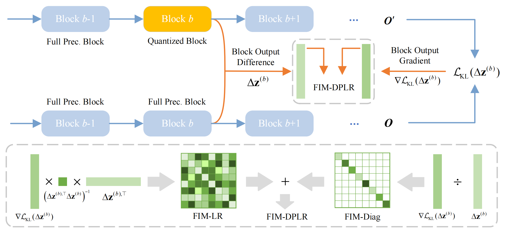

## FIMA-Q: Post-Training Quantization for Vision Transformers by Fisher Information Matrix Approximation

## Experiment scripts

`scripts/run.sh` contains the commands for the current experiments. The
original `test_quant.py` automatically creates a timestamped `output.log` under
`checkpoints/quant_result/`, and that log records the command-line arguments and
the final configuration. Runs launched by `run.sh` also include the experiment
name in the result directory. After a run finishes successfully, its log is
copied to `logs/`; failed and interrupted logs remain only in `quant_result/`.

```bash
bash scripts/run.sh verify
bash scripts/run.sh k15
bash scripts/run.sh mse
```

This repository contains the official PyTorch implementation for the CVPR 2025 paper "[FIMA-Q: Post-Training Quantization for Vision Transformers by Fisher Information Matrix Approximation](https://arxiv.org/abs/2506.11543)".



## Getting Started

- Clone this repo.

```bash
git clone git@github.com:ShiheWang/FIMA-Q.git
cd FIMA-Q
```

- Install pytorch and [timm](https://github.com/huggingface/pytorch-image-models/tree/main).

```bash
pip install torch==2.2.2 torchvision --index-url https://download.pytorch.org/whl/cu121
pip install timm==0.9.2
```

All the pretrained models can be obtained using timm. You can also directly download the checkpoints we provide. For example:

```bash
wget https://github.com/GoatWu/AdaLog/releases/download/v1.0/deit_tiny_patch16_224.bin
mkdir -p ./checkpoints/vit_raw/
mv deit_tiny_patch16_224.bin ./checkpoints/vit_raw/
```

### ViT-S 权重位置与启动日志

本项目的 ViT-S 量化实验使用 [timm 的 AugReg ViT-S/16 224 权重](https://huggingface.co/timm/vit_small_patch16_224.augreg_in21k_ft_in1k)。模型先在 ImageNet-21k 上预训练，再在 ImageNet-1k 上微调。

| 文件位置 | 用途 |
|---|---|
| `checkpoints/vit_raw/model.safetensors` | 项目内的浮点预训练权重。已在 Windows 工作区核对，共 88,216,496 字节。该文件由 Git 忽略，服务器的同名文件需独立检查。 |
| `checkpoints/vit_raw/vit_small_patch16_224.bin` | 直接运行 `test_quant.py` 且未传 `--fp-checkpoint` 时尝试的默认路径。 |
| `~/.cache/huggingface/hub/models--timm--vit_small_patch16_224.augreg_in21k_ft_in1k/snapshots/<revision>/model.safetensors` | Hugging Face 的默认缓存位置。实际根目录取决于服务器的缓存设置。 |
| `checkpoints/lsvit_controls/mr/seed*/relu_mlp.pth` | MR 阶段保存的逐块 ReLU MLP 权重，由对应的 `mr_screen.json` 关联。 |
| `checkpoints/quant_result/<run>/` | 校准和正式量化后的整网 checkpoint。LS/MR 最终保存位置记录在对应的 `method_result.json` 的 `checkpoint_after` 字段。 |

`scripts/run_lsvit_mr.py` 和 `scripts/run_lsvit_controls.py` 优先使用显式的 `--fp-checkpoint`，其次检查项目内的 `model.safetensors` 和默认 `.bin`，按这个顺序选择。两者都缺失时，`test_quant.py` 尝试默认 `.bin` 后调用 `timm.create_model(..., pretrained=True)`。看到 `No checkpoint found` 后，若日志继续显示从 Hub 加载且模型指纹检查通过，可以继续运行。 [timm 的加载实现](https://github.com/huggingface/pytorch-image-models/blob/v0.9.2/timm/models/_hub.py) · [Hugging Face 缓存说明](https://huggingface.co/docs/huggingface_hub/en/guides/manage-cache)

- 与历史 LS/MR 运行日志一致的模型参数 SHA256 为
  `a78205f203d9299dd770d74b9f4273895a7d2a22260593bdbe7908e4e513463c`
- 用于核对 Windows 上 `model.safetensors` 复制结果的文件 SHA256 为
  `79c03c635cdfd798a364a9d8c4e5c0b7255b975ea2c9616046d4f77ab01435aa`

计划使用本地权重的一批实验开始前，在服务器的 `fimaq` 环境下运行：

```bash
cd ~/autodl-tmp/FIMA-Q-Reproduction/FIMA-Q
conda activate fimaq
python scripts/prepare_vit_small_weights.py
```

脚本优先校验项目中已有的文件。若文件缺失，则从本机 Hugging Face 缓存复制并校验 SHA256。若缓存也缺失，可以用 `--source /path/to/model.safetensors` 指定已传到服务器的文件。新启动的 MR 和 LS 脚本会自动发现项目内的权重。直接调用 `test_quant.py` 时，使用 `--fp-checkpoint checkpoints/vit_raw/model.safetensors`。

已经使用 Hub 路径开始的配对实验，建议整批结束并汇总后再安装项目内的权重。MR 和 LS 脚本会把权重路径和本地文件 SHA256 纳入运行标识，切换路径后，`--resume` 和汇总可能转到新的结果目录，即使加载的是相同的模型参数。

如需只查询本机缓存位置，可以运行：

```bash
cd ~/autodl-tmp/FIMA-Q-Reproduction/FIMA-Q
ls -lh checkpoints/vit_raw/
python - <<'PY'
from huggingface_hub import try_to_load_from_cache

repo = "timm/vit_small_patch16_224.augreg_in21k_ft_in1k"
path = try_to_load_from_cache(repo, "model.safetensors")
print(path if isinstance(path, str) else "当前环境未找到缓存的 model.safetensors")
PY
```

## Evaluation

You can quantize and evaluate a single model using the following command:

```bash
python test_quant.py --model <MODEL> --config <CONFIG_FILE> --dataset <DATA_DIR> [--calibrate] [--load-calibrate-checkpoint <CALIB_CKPT>] [--optimize]
```

- `--model <MODEL>`: Model architecture, which can be `deit_tiny`, `deit_small`, `deit_base`, `vit_tiny`, `vit_small`, `vit_base`, `swin_tiny`, `swin_small` and `swin_base`.

- `--config <CONFIG_FILE>`: Path to the model quantization configuration file.

- `--dataset <DATA_DIR>`: Path to ImageNet dataset.

- `--calibrate` and `--load-calibrate-checkpoint <CALIB_CKPT>`: A `mutually_exclusive_group` to choose between quantizing an existing model or directly load a calibrated model. The default selection is `--calibrate`.

- `--optimize`: Whether to perform Adaround optimization after calibration.

Example: Optimize the model after calibration.

```bash
python test_quant.py --model vit_small --config ./configs/3bit/best.py --dataset ~/data/ILSVRC/Data/CLS-LOC --val-batch-size 500 --calibrate --optimize --optim-metric fisher_dplr
```

Example: Load a calibrated checkpoint, then run optimization.

```bash
python test_quant.py --model vit_small --config ./configs/3bit/best.py --dataset ~/data/ILSVRC/Data/CLS-LOC --val-batch-size 500 --load-calibrate-checkpoint ./checkpoints/quant_result/vit_small_w3_a3_calibsize_128_mse.pth --optimize --optim-metric fisher_dplr
```

Example: Load an optimized checkpoint and test.

```bash
python test_quant.py --model vit_small --config ./configs/3bit/best.py --dataset ~/data/ILSVRC/Data/CLS-LOC --val-batch-size 500 --load-optimize-checkpoint ./checkpoints/quant_result/vit_small_w3_a3_optimsize_1024_fisher_dplr_dis_mode_q_rank_15_qdrop.pth --test-optimize-checkpoint 
```

## Results

Below are the experimental results of our proposed APHQ-ViT that you should get on ImageNet dataset. Checkpoints are available in [Google Drive](https://drive.google.com/drive/folders/1PxzP9O8dnXVeACTJJl4nHrQlVI_kpuz-?usp=drive_link).

| Model | **Full Prec.** | **W4/A4** | **W3/A3** |
|:----------:|:--------------:|:---------:|:---------:|
| **ViT-S**  | 81.39          | 76.68     | 64.09     |
| **ViT-B**  | 84.54          | 83.04     | 77.63     |
| **DeiT-T** | 72.21          | 66.84     | 55.55     |
| **DeiT-S** | 79.85          | 76.87     | 69.13     |
| **DeiT-B** | 81.80          | 80.33     | 76.54     |
| **Swin-S** | 83.23          | 81.82     | 77.26     |
| **Swin-B** | 85.27          | 83.60     | 78.82     |

## Citation

If you find our work useful in your research, please consider citing:

```bibtex
@inproceedings{wu2025fimaq,
title={FIMA-Q: Post-Training Quantization for Vision Transformers by Fisher Information Matrix Approximation},
author={Wu, Zhuguanyu and Wang, Shihe and Zhang, Jiayi and Chen, Jiaxin and Wang, Yunhong},
booktitle={IEEE/CVF Conference on Computer Vision and Pattern Recognition (CVPR)},
year={2025}
}
```
